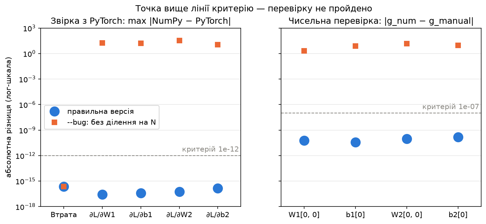
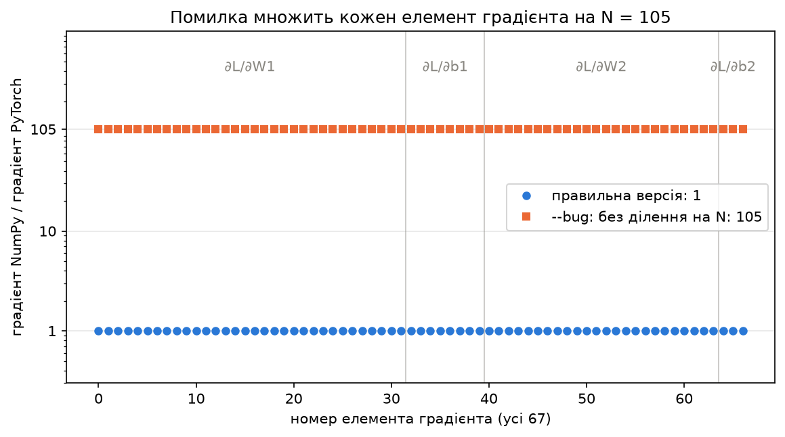

# ЛР1. Реалізація та перевірка зворотного поширення похибки

Гула Дарина

## Що робить код і як запустити

Мережа `X → Linear(4, 8) → ReLU → Linear(8, 3)` на Iris: прямий прохід, стабільна крос-ентропія
і зворотний прохід написані вручну в NumPy (float64). Градієнти перевіряються двома способами —
PyTorch autograd (усі 67 елементів) і чисельне диференціювання (4 елементи) — на початкових
параметрах і повній навчальній вибірці (105 об'єктів), без навчання. Прапорець `--bug` вмикає
навмисну помилку (немає ділення на $N$ у градієнті за логітами), яку ці перевірки мають виявити.

Потрібен [uv](https://docs.astral.sh/uv/). З теки `lab1/`:

```bash
uv run main.py
```

```bash
uv run main.py --bug
```

Перша команда — правильна реалізація (пункти 1–3), друга — дослід із помилкою (пункт 4). Датасет
окремо не потрібен (`sklearn.datasets.load_iris()`), версії зафіксовані в `uv.lock`. Кожен запуск
друкує таблиці, зберігає числа в `results/correct.json` або `results/bug.json` і оновлює графіки
в `results/`. Усі числа нижче взято з цих файлів, округлення — лише для відображення.

| Файл | Що в ньому |
|---|---|
| `data.py` | Iris, поділ 35/15 на клас (`default_rng(0)`), стандартизація статистиками train (`ddof=0`) |
| `net.py` | ініціалізація, `forward`, `cross_entropy`, `backward` |
| `torch_ref.py` | еталон на PyTorch (лише для звірки) |
| `main.py` | перевірки, таблиці, json |
| `plots.py` | графіки зі збережених json |

Середовище: Python 3.12.16, numpy 2.5.4, scikit-learn 1.9.1, torch 2.15.0+cpu,
matplotlib 3.11.2, Windows 10.

## Результати

### Формули та розмірності

$N = 105$, $Y$ — one-hot матриця міток, ваги зберігаються як (in, out).

Прямий прохід і втрата (log-softmax зі зсувом на максимум рядка $m_n$):

$$Z_1 = X W_1 + b_1, \qquad H = \max(Z_1, 0), \qquad Z_2 = H W_2 + b_2$$

$$\log p_{nk} = (Z_{2,nk} - m_n) - \log \sum_{j} e^{Z_{2,nj} - m_n}, \qquad L = -\frac{1}{N} \sum_{n=1}^{N} \log p_{n, y_n}$$

Зворотний прохід:

$$\frac{\partial L}{\partial Z_2} = \frac{1}{N}(P - Y), \qquad
\frac{\partial L}{\partial W_2} = H^\top \frac{\partial L}{\partial Z_2}, \qquad
\frac{\partial L}{\partial b_2} = \sum_{n} \frac{\partial L}{\partial Z_{2,n}}$$

$$\frac{\partial L}{\partial H} = \frac{\partial L}{\partial Z_2} W_2^\top, \qquad
\frac{\partial L}{\partial Z_1} = \frac{\partial L}{\partial H} \odot [Z_1 > 0]$$

$$\frac{\partial L}{\partial W_1} = X^\top \frac{\partial L}{\partial Z_1}, \qquad
\frac{\partial L}{\partial b_1} = \sum_{n} \frac{\partial L}{\partial Z_{1,n}}$$

| Масиви | Розмірність |
|---|---|
| $X$ | (105, 4) |
| $Z_1$, $H$, $\partial L/\partial H$, $\partial L/\partial Z_1$ | (105, 8) |
| $Z_2$, $P$, $\partial L/\partial Z_2$ | (105, 3) |
| $\partial L/\partial W_1$ | (4, 8) |
| $\partial L/\partial b_1$ | (8,) |
| $\partial L/\partial W_2$ | (8, 3) |
| $\partial L/\partial b_2$ | (3,) |

**Збережені проміжні значення.** Зворотному проходу потрібні `X` (множник у градієнті $W_1$),
`Z1` (маска ReLU), `H` (множник у градієнті $W_2$) — їх повертає `forward()` у `cache` — та
ймовірності `P` з `cross_entropy()` (початок зворотного проходу). `Z2` не зберігається: з логітів
потрібні лише `P`.

**Чому зсув на максимум.** Множник $e^{-m_n}$ скорочується, тож результат той самий, але найбільший
показник експоненти дорівнює 0: `exp` не переповнюється, а під логарифмом число не менше за 1.

### Звірка з PyTorch

Втрата NumPy `1.4562007801142816`, PyTorch `1.4562007801142818`. Критерій: $|a - b| \le 10^{-12}$,
усі значення скінченні. `nn.Linear` зберігає вагу як (out, in), тому ваги копіюються транспонованими.

| Величина | Максимальна абсолютна різниця NumPy / PyTorch | Перевірку пройдено |
|---|---|---|
| Втрата | 2.220e-16 | так |
| Градієнт $W_1$ | 2.776e-17 | так |
| Градієнт $b_1$ | 3.990e-17 | так |
| Градієнт $W_2$ | 5.551e-17 | так |
| Градієнт $b_2$ | 1.388e-16 | так |

### Чисельна перевірка

$g_{\mathrm{num}} = (L_+ - L_-) / (2\varepsilon)$, $\varepsilon = 10^{-6}$. Критерій:
$|g_{\mathrm{num}} - g_{\mathrm{manual}}| \le 10^{-7}$.

| Параметр | Градієнт `backward()` | Чисельна похідна | Абсолютна різниця | Перевірку пройдено |
|---|---|---|---|---|
| $W_1[0, 0]$ | -0.019920184331 | -0.019920184391 | 6.034e-11 | так |
| $b_1[0]$ | -0.070566111584 | -0.070566111621 | 3.633e-11 | так |
| $W_2[0, 0]$ | 0.135230208605 | 0.135230208698 | 9.218e-11 | так |
| $b_2[0]$ | 0.085521644842 | 0.085521644988 | 1.460e-10 | так |

### Дослід із навмисною помилкою (`--bug`)

У градієнті за логітами немає ділення на $N$: $\partial L/\partial Z_2 = P - Y$. Функція втрат,
параметри, 105 об'єктів, еталон PyTorch і формула чисельної похідної ті самі.

**Прогноз (записано до запуску, коміт `6ff1c52`):**

> втрата не зміниться, бо її рахує прямий прохід, а помилку внесено тільки у backward.
>
> Усі ненульові градієнти стануть у 105 разів більшими (N = 105), бо ділення пропущене на першому кроці, а далі градієнти отримуються з нього множенням; напрям не зміниться, зміниться лише масштаб.
>
> Помилку виявлять обидві перевірки: звірка з PyTorch (він рахує правильний градієнт) і чисельна перевірка (сама чисельна похідна не зміниться, бо рахується через втрату, але вона не збіжеться з завеликими градієнтами backward).

**Результат.** Втрата: NumPy `1.4562007801142816`, PyTorch `1.4562007801142818` — як у правильній версії.

| Величина | Максимальна абсолютна різниця NumPy / PyTorch | Перевірку пройдено |
|---|---|---|
| Втрата | 2.220e-16 | так |
| Градієнт $W_1$ | 1.852e+01 | НІ |
| Градієнт $b_1$ | 1.564e+01 | НІ |
| Градієнт $W_2$ | 3.419e+01 | НІ |
| Градієнт $b_2$ | 1.120e+01 | НІ |

| Параметр | Градієнт `backward()` | Чисельна похідна | Абсолютна різниця | Перевірку пройдено |
|---|---|---|---|---|
| $W_1[0, 0]$ | -2.091619354708 | -0.019920184391 | 2.072e+00 | НІ |
| $b_1[0]$ | -7.409441716360 | -0.070566111621 | 7.339e+00 | НІ |
| $W_2[0, 0]$ | 14.199171903575 | 0.135230208698 | 1.406e+01 | НІ |
| $b_2[0]$ | 8.979772708405 | 0.085521644988 | 8.894e+00 | НІ |

Відношення «градієнт NumPy / градієнт PyTorch» по всіх 67 елементах (усі ненульові):
від 105.000000000000 до 105.000000000002; у правильній версії — 1.000000000000.

**Зіставлення з прогнозом.** Усі три пункти справдилися: втрата однакова в обох режимах, усі 67
елементів градієнта більші рівно в 105 разів із тим самим знаком, обидві перевірки не пройдено
(4 з 4 градієнтів у кожній). Причина — весь зворотний прохід лінійний за $\partial L/\partial Z_2$,
тож пропущений множник $1/N$ переходить у кожен градієнт. Правильна реалізація працює за
замовчуванням, помилка — лише за прапорцем `--bug`.

### Графіки



Абсолютні різниці обох перевірок на лог-шкалі: правильна версія лежить приблизно на 3–4 порядки
нижче своїх критеріїв, градієнти версії `--bug` — на 7–13 порядків вище; втрата збігається в обох
режимах.



Відношення ручного градієнта до еталонного для кожного з 67 елементів: 1 у правильній версії
і 105 з `--bug`.

## Висновки та інсайти

1. Ручний зворотний прохід збігається з PyTorch autograd у всіх 67 елементах градієнта до машинної точності (≤ 1.4e-16 при критерії 1e-12).
2. Чисельна похідна підтверджує чотири перевірені елементи з різницею ≤ 1.5e-10 при критерії 1e-7; ця різниця — похибка округлення втрати (~1e-16), поділена на $2\varepsilon$.
3. Дві перевірки незалежні: PyTorch порівнює всі елементи з іншою реалізацією, а чисельна похідна спирається лише на функцію втрат і не використовує `backward()`.
4. Помилка масштабу в градієнті не змінює втрату, тому за самою втратою її не видно — виявляють її тільки перевірки градієнтів.
5. Градієнт, більший у 105 разів, має той самий напрям, тож у навчанні така помилка виглядала б як крок навчання, більший у 105 разів, і її легко сплутати з невдалим добором кроку.
6. Градієнт за логітами мусить відповідати функції втрат: `(P − Y) / N` для середнього за об'єктами, `P − Y` — для суми.

## Використані інструменти

- Claude Code (Anthropic) — допомога з написанням коду, перевірок, графіків і оформленням README.
- Документація NumPy, PyTorch, scikit-learn, Matplotlib, uv.
- Стороннього коду з інших джерел не використано.
