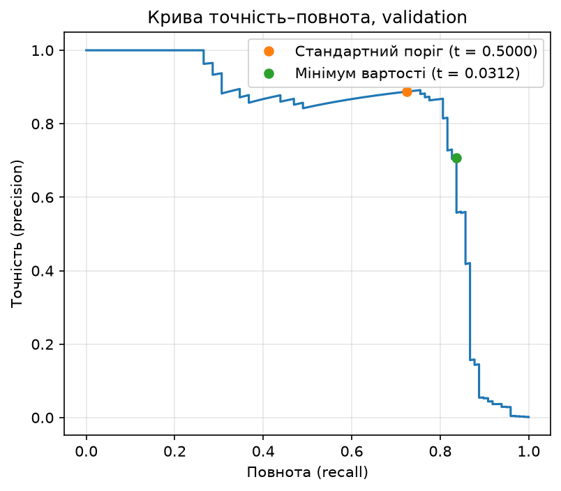
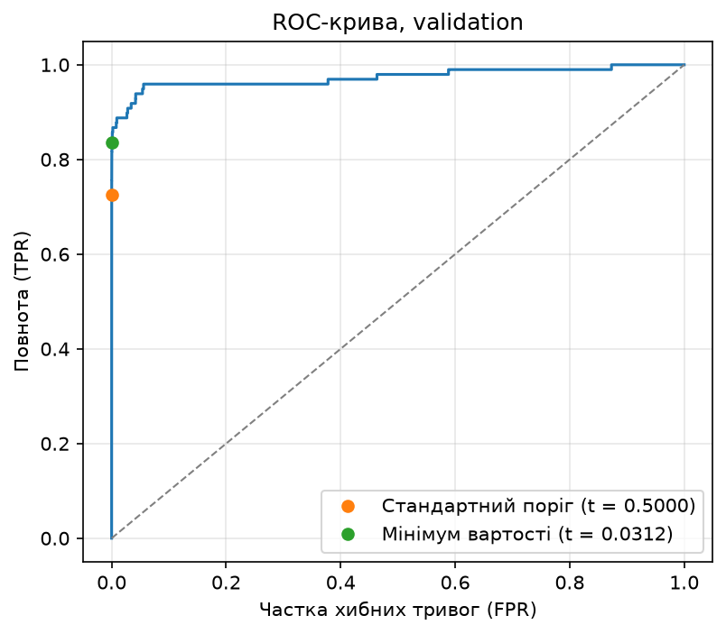

# ЛР2. Поріг рішення під асиметричну ціну помилок

Гула Дарина

## Що робить код і як запустити

Мережа `Linear(29, 32) → ReLU → Linear(32, 1)` навчається один раз на наборі Credit Card Fraud
Detection, її оцінки для validation і test зберігаються. Далі модель не змінюється: на validation
шукається поріг $t^{\ast}$ з мінімальною вартістю помилок $C = 10 \cdot FN + FP$, пошук перевіряється
незалежним прямим перебором на трьох малих наборах, і лише після цього зафіксований $t^{\ast}$ один
раз застосовується до test.

Потрібен [uv](https://docs.astral.sh/uv/), команди — з теки `lab2/`. Датасет:
[Credit Card Fraud Detection на Kaggle](https://www.kaggle.com/datasets/mlg-ulb/creditcardfraud),
файл `creditcard.csv` (потрібен обліковий запис Kaggle); у репозиторії його немає, шлях передається
аргументом `--data`.

Навчання з локального CSV (близько пів хвилини на CPU; `--out` — нова або порожня тека, мої
результати вже лежать у `results/`):

```bash
uv run python train.py --data <шлях до creditcard.csv> --out results_rerun
```

Аналіз зі збережених прогнозів, без навчання і без CSV (кілька секунд, дає числа цього README):

```bash
uv run python analyze.py --saved results --out analysis
```

Звірка повторного навчання з моїм (той самий поділ і статистики стандартизації):

```bash
uv run python analyze.py --saved results --out analysis --compare results_rerun
```

| Файл | Що в ньому |
|---|---|
| `train.py` | стартовий код викладача (поділ, стандартизація, навчання, збереження) + `check_split` |
| `threshold.py` | $TP, FP, FN, TN$, вартість $C$, швидкий пошук порога |
| `check_small.py` | набори A/B/C і незалежний прямий перебір |
| `analyze.py` | команда аналізу: пункт 2 → пункт 3 → пункт 4 |
| `results/` | ваги `model.pt`, `predictions.npz` (індекси поділу, мітки, `Amount`, оцінки без округлення), статистики стандартизації, `run.json` |
| `analysis/` | `candidates.csv` (повна таблиця кандидатів), `analysis.json` (усі числа, зокрема $t^{\ast}$), криві, `small_checks.csv`, `test_errors.csv`, `tables.md` |

Усі числа нижче взято з `analysis/analysis.json` і `analysis/tables.md`, округлення — лише для
відображення. Середовище: Python 3.12.16, numpy 2.5.4, pandas 3.1.1, scikit-learn 1.9.1,
torch 2.15.0+cpu, matplotlib 3.11.2, Windows 10 (версії зафіксовані в `uv.lock`).

## Результати

### Поділ

`train_test_split` для індексів рядків: `test_size=0.4, stratify=Class, random_state=0`, потім
відкладені 40% навпіл (`test_size=0.5`, стратифікація, `random_state=0`): перша половина —
validation, друга — test. `StandardScaler` навчено лише на train. Код перевіряє, що частини не
перетинаються і разом дають 284 807 рядків і 492 шахрайські транзакції.

| Частина | Об'єктів | Шахрайських | Частка |
|---|---|---|---|
| train | 170884 | 295 | 0.001726 |
| validation | 56961 | 98 | 0.001720 |
| test | 56962 | 99 | 0.001738 |

**Чому статистики стандартизації не можна рахувати на всьому наборі.** Середнє і відхилення — теж
параметри, оцінені з даних: якщо рахувати їх на всіх рядках, інформація про validation і test
потрапляє в підготовку train, і оцінка на них перестає бути чесною оцінкою роботи на нових
транзакціях.

### Формули і пошук порога

Шахрайство прогнозується, якщо $s_i \ge t$.

$$TP(t) = \sum_{i:\ s_i \ge t} y_i, \quad FP(t) = \sum_{i:\ s_i \ge t} (1 - y_i), \quad
FN(t) = \sum_{i:\ s_i \lt t} y_i, \quad TN(t) = \sum_{i:\ s_i \lt t} (1 - y_i)$$

$$C(t) = 10 \cdot FN(t) + FP(t), \qquad
\text{precision} = \frac{TP}{TP + FP}, \qquad \text{recall} = \frac{TP}{TP + FN}$$

**Пошук.** Кандидати — усі унікальні оцінки validation і $+\infty$ («усі негативні»). Оцінки
сортуються за спаданням, рахуються кумулятивні суми міток, і лічильники читаються лише в кінці
кожної групи рівних оцінок, тому рівні оцінки завжди отримують однаковий прогноз; складність
$O(n \log n)$, без окремого проходу для кожного порога. Серед порогів із мінімальною $C$ береться
найбільший.

### Вибір порога на validation

Кандидатів 55 945 (55 944 унікальні оцінки і $+\infty$), мінімум вартості досягається на одному
порозі: $t^{\ast} = 0.03119388222694397$. Повна таблиця — `analysis/candidates.csv`.

| Правило на validation | Поріг | TP | FP | FN | TN | C | precision | recall |
|---|---|---|---|---|---|---|---|---|
| Стандартний поріг | 0.500000 | 71 | 9 | 27 | 56854 | 279 | 0.8875 | 0.7245 |
| Мінімум вартості | 0.031194 | 82 | 34 | 16 | 56829 | 194 | 0.7069 | 0.8367 |
| Усі негативні | +∞ | 0 | 0 | 98 | 56863 | 980 | не визначена | 0.0000 |





ROC-AUC на validation = 0.973318.

**Чому висока ROC-AUC не гарантує малої вартості чи високої точності.** ROC-AUC описує
впорядкування оцінок, усереднене за всіма порогами, а $C$ залежить від одного порога: та сама
модель дає $C$ = 279, 194 або 980. До того ж FPR ділить на 56 863 негативних: при $t^{\ast}$
$FPR = 34 / 56863 \approx 0.0006$, але ці 34 тривоги проти 82 знайдених шахрайств — це вже точність
лише 0.7069.

### Перевірка пошуку на наборах A/B/C

`check_small.py` не імпортує `threshold.py`: для кожного кандидата він окремим циклом застосовує
$s_i \ge t$. Стовпці TP–C — прямий перебір, «Швидкий» — кумулятивні суми; кандидати, лічильники,
вартості й вибраний поріг мають збігтися точно, інакше аналіз зупиняється до читання test.

**A.** $s = [0.9; 0.7; 0.7; 0.4; 0.2; 0.1]$, $y = [0; 1; 0; 1; 0; 0]$.

| Поріг | TP | FP | FN | TN | C | Швидкий: TP/FP/FN/TN/C | Вибрано |
|---|---|---|---|---|---|---|---|
| +∞ | 0 | 0 | 2 | 4 | 20 | 0/0/2/4/20 |  |
| 0.9 | 0 | 1 | 2 | 3 | 21 | 0/1/2/3/21 |  |
| 0.7 | 1 | 2 | 1 | 2 | 12 | 1/2/1/2/12 |  |
| 0.4 | 2 | 2 | 0 | 2 | 2 | 2/2/0/2/2 | t\* |
| 0.2 | 2 | 3 | 0 | 1 | 3 | 2/3/0/1/3 |  |
| 0.1 | 2 | 4 | 0 | 0 | 4 | 2/4/0/0/4 |  |

**B.** $s = [0.9; 0.6; 0.3]$, $y = [0; 0; 0]$.

| Поріг | TP | FP | FN | TN | C | Швидкий: TP/FP/FN/TN/C | Вибрано |
|---|---|---|---|---|---|---|---|
| +∞ | 0 | 0 | 0 | 3 | 0 | 0/0/0/3/0 | t\* |
| 0.9 | 0 | 1 | 0 | 2 | 1 | 0/1/0/2/1 |  |
| 0.6 | 0 | 2 | 0 | 1 | 2 | 0/2/0/1/2 |  |
| 0.3 | 0 | 3 | 0 | 0 | 3 | 0/3/0/0/3 |  |

**C.** 13 об'єктів: оцінка 0.8 з міткою 1; одинадцять оцінок 0.5 (перша з міткою 1, решта десять —
з міткою 0); оцінка 0.2 з міткою 0.

| Поріг | TP | FP | FN | TN | C | Швидкий: TP/FP/FN/TN/C | Вибрано |
|---|---|---|---|---|---|---|---|
| +∞ | 0 | 0 | 2 | 11 | 20 | 0/0/2/11/20 |  |
| 0.8 | 1 | 0 | 1 | 11 | 10 | 1/0/1/11/10 | t\* |
| 0.5 | 2 | 10 | 0 | 1 | 10 | 2/10/0/1/10 |  |
| 0.2 | 2 | 11 | 0 | 0 | 11 | 2/11/0/0/11 |  |

Обрані пороги: A — 0.4, B — $+\infty$, C — 0.8; перебір і швидкий пошук збіглися в усіх трьох наборах.

- **A — рівні оцінки.** Дві оцінки 0.7 з різними мітками мають отримати однаковий прогноз: кандидат
  0.7 забирає обидві одразу ($TP = 1$, $FP = 2$), проміжного стану $TP = 1$, $FP = 1$ не існує.
- **B — немає позитивних міток.** $FN = 0$ за будь-якого порога, тож мінімум $C = 0$ дає лише
  $+\infty$: перевіряється, що граничний кандидат є у списку і код не ламається при $P = 0$.
- **C — два кандидати з однаковою вартістю.** Пороги 0.8 ($FN = 1$, $FP = 0$) і 0.5 ($FN = 0$,
  $FP = 10$) коштують по 10; правило нічиєї має вибрати найбільший, тобто 0.8.

### Тестова оцінка

$t^{\ast}$ зафіксовано на validation і застосовано до test (56 962 об'єкти, 99 шахрайських) один раз.

| | Прогноз: шахрайство | Прогноз: легітимна |
|---|---|---|
| **Мітка 1 (шахрайство)** | TP = 80 | FN = 19 |
| **Мітка 0 (легітимна)** | FP = 43 | TN = 56820 |

$$C = 10 \cdot 19 + 43 = 233, \qquad \text{precision} = \frac{80}{123} = 0.6504, \qquad \text{recall} = \frac{80}{99} = 0.8081$$

**Коли метрика не визначена.** Якщо $TP + FP = 0$, тривог не було і точність — це $0/0$ (так за
порога $+\infty$); якщо $TP + FN = 0$, шахрайств у вибірці немає і повнота — теж $0/0$ (набір B).
Будь-яке число тут було б вигаданим, тому код повертає `None`, а не 0.

Для порівняння ті самі лічильники за порога 0.5; рядок test при 0.5 обчислено після фіксації
$t^{\ast}$, і він ні на що не впливав.

| Вибірка | Поріг | FN | FP | C |
|---|---|---|---|---|
| validation | 0.5 | 27 | 9 | 279 |
| validation | $t^{\ast}$ | 16 | 34 | 194 |
| test | 0.5 | 28 | 8 | 288 |
| test | $t^{\ast}$ | 19 | 43 | 233 |

### Розібрані помилки на test

Перші п'ять FP і перші п'ять FN за номером рядка CSV (`analysis/test_errors.csv`):

| Рядок CSV (від 0, без заголовка) | Тип помилки | Мітка | Оцінка s | Amount | s − t\* |
|---|---|---|---|---|---|
| 460 | FP | 0 | 0.196159 | 2.00 | +0.164965 |
| 2961 | FP | 0 | 0.080961 | 2.49 | +0.049767 |
| 10783 | FP | 0 | 0.966327 | 89.99 | +0.935133 |
| 13405 | FP | 0 | 0.932032 | 89.99 | +0.900838 |
| 13617 | FP | 0 | 0.922762 | 89.99 | +0.891568 |
| 10497 | FN | 1 | 0.011464 | 3.79 | -0.019730 |
| 52521 | FN | 1 | 0.006373 | 105.99 | -0.024821 |
| 55401 | FN | 1 | 0.005642 | 1.00 | -0.025552 |
| 91671 | FN | 1 | 0.000500 | 290.18 | -0.030693 |
| 93486 | FN | 1 | 0.018352 | 0.00 | -0.012842 |

**Amount і відстань від порога.** Межі за сумою між FP і FN немає: малі суми є в обох групах
(FP: 2.00–89.99, FN: 0.00–290.18). Три FP з однаковою сумою 89.99 лежать далеко над порогом
(оцінки понад 0.92), усі FN — близько під ним, але напряму порівнювати ці відстані не можна: FN не
може бути далі від порога, ніж $t^{\ast} \approx 0.031$, а FP — може бути на відстані до 0.969.

**Чи можна за десятьма прикладами судити про причину помилок?** Ні: це не випадкова вибірка, а
найраніші за `Time` помилки з 43 FP і 19 FN, і за всіма помилками картина інша (медіана
$|s - t^{\ast}|$ для FP — 0.0250, тобто половина хибних тривог лежить ближче ніж 0.025 до порога). Оцінку визначають
анонімізовані `V1`–`V28`, тож десять прикладів годяться для гіпотез, але не для висновку.

## Висновки та інсайти

1. Вибір порога не змінив модель (ті самі ваги, оцінки й ROC-AUC) — змінилося лише місце, де оцінка стає рішенням: поріг опустився з 0.5 до 0.0312, бо пропущене шахрайство коштує вдесятеро більше за хибну тривогу.
2. Ціна рішення на validation — 25 додаткових хибних тривог ($FP$: 9 → 34) за 11 додатково знайдених шахрайств ($FN$: 27 → 16), $C$: 279 → 194; на test — 35 тривог за 9 шахрайств, $C$: 288 → 233.
3. Платою є точність: на validation вона впала з 0.8875 до 0.7069, на test дорівнює 0.6504 — приблизно кожна третя тривога хибна.
4. Validation не гарантує такого самого виграшу на test (85 проти 55), бо $t^{\ast}$ — найкращий із 55 945 кандидатів саме на цій вибірці, а шахрайств лише 98 і 99, тож кілька транзакцій по інший бік порога помітно змінюють $C$; чесна оцінка — число з test.
5. ROC-AUC 0.97 не показує ні вартості, ні точності: за сильного дисбалансу їх видно лише в конкретній робочій точці та на PR-кривій.
6. Незалежний прямий перебір на наборах A/B/C перевіряє саме ті місця, де швидкий пошук легко зламати: рівні оцінки, граничний поріг $+\infty$ і правило нічиєї.

## Використані інструменти

- Стартовий код викладача `lab2_starter.py` — основа `train.py`; додано лише функції `check_split` і `saved_parts`.
- Claude Code (Anthropic) — допомога з написанням коду аналізу, перевірок і оформленням README.
- scikit-learn — `precision_recall_curve`, `roc_curve`, `roc_auc_score` для кривих і ROC-AUC (дозволено умовою); лічильники, вартість і пошук порога реалізовано власноруч.
- Документація NumPy, pandas, PyTorch, scikit-learn, Matplotlib, uv.
- Стороннього коду з інших джерел не використано.
