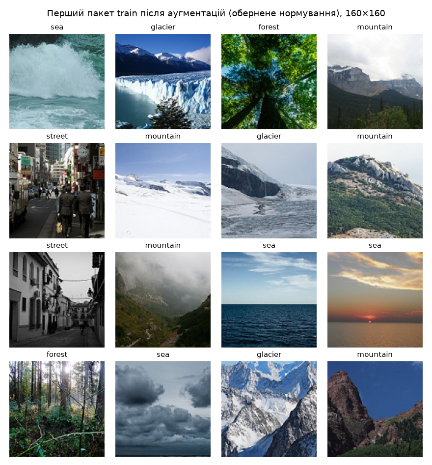
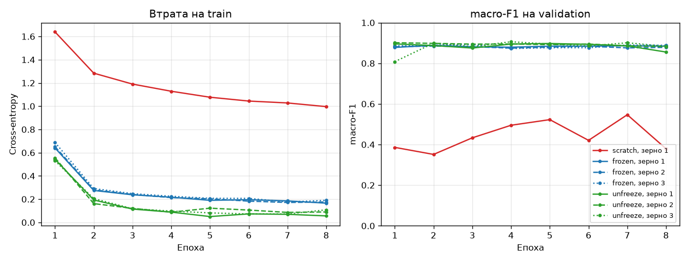
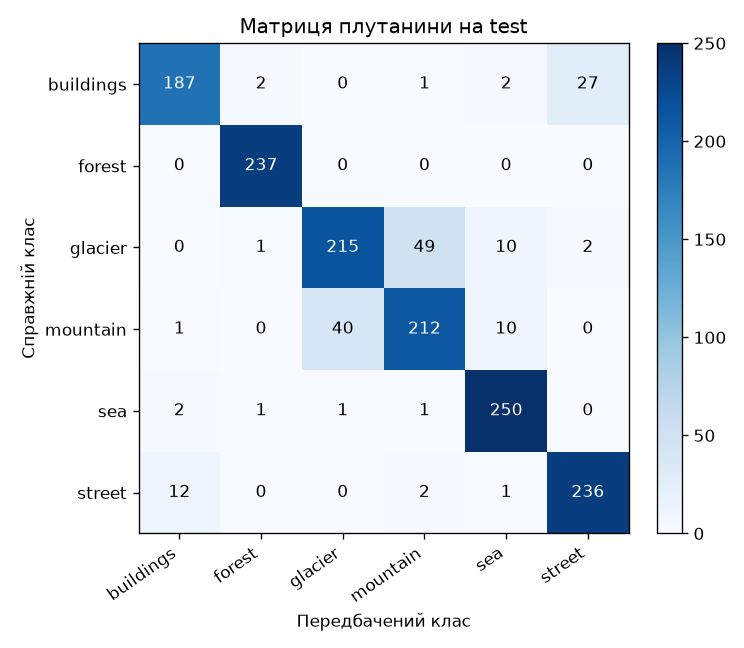
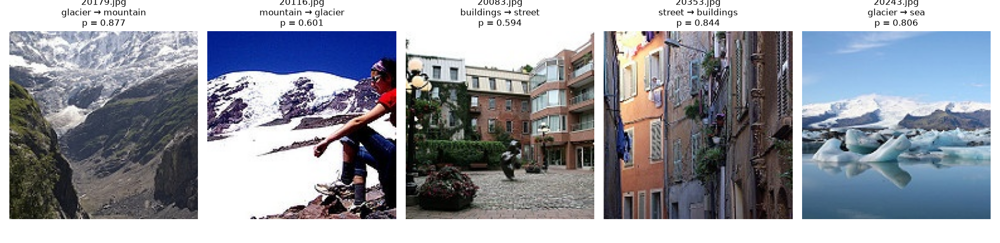

# ЛР3. Обчислювальний експеримент і трансферне навчання

Гула Дарина

## Що робить код і як запустити

ResNet-18 навчається на 200 зображеннях на клас набору Intel Image Classification у трьох режимах:
`scratch` (усе з нуля), `frozen` (ImageNet-кістяк заморожено, навчається лише `fc`) і `unfreeze`
(навчаються `layer4` і `fc`). Бюджет однаковий: 304 кроки AdamW. Сім запусків (scratch × 1 зерно,
frozen і unfreeze × 3 зерна) дають два ефекти — попереднього навчання Δpre і розморожування Δunf —
які порівнюються з розкидом між зернами. Test використовується один раз, лише в команді аналізу.

Потрібен [uv](https://docs.astral.sh/uv/), команди — з теки `lab3/`. Набір:
[Intel Image Classification на Kaggle](https://www.kaggle.com/datasets/puneet6060/intel-image-classification);
`--data` — тека, в якій лежать `seg_train/seg_train/` і `seg_test/seg_test/` (у репозиторії набору немає).
Ваги ImageNet torchvision завантажує сам під час першого запуску.

Навчання: поділ і `split.csv`, перевірки пунктів 1–2, дослід із BN, сім запусків, вибір і
`lab3_model.pt` (на GeForce MX550 близько 5 хвилин, на CPU значно довше; `--out` — нова тека,
мої результати вже лежать у `lab3/`):

```bash
uv run python train.py --data <тека набору> --out rerun
```

Аналіз: хеш `split.csv` у журналах, таблиця, криві, ефекти, перевірка вибору, потім test на CPU
(близько хвилини; дає всі числа цього README):

```bash
uv run python analyze.py --data <тека набору>
```

| Файл | Що в ньому |
|---|---|
| `data.py` | поділ за процедурою умови і звірка з контрольною таблицею, перетворення, завантажувачі |
| `model.py` | побудова моделі (кроки 1–5), `set_train_mode`, групи AdamW, підрахунок параметрів |
| `loop.py` | епоха навчання, логіти, macro-F1 |
| `checks.py` | пункти 1–2: рисунок пакета, $L_0$, параметри, що змінюється за 5 кроків, дослід із BN |
| `train.py` | команда навчання (без test) |
| `analyze.py` | команда аналізу (єдине місце, де завантажується test) |
| `split.csv`, `results/` | поділ; `split_check.json`, `checks.json`, `bn_experiment.json`, `selection.json`, `batch.png`, журнали виводу |
| `runs/<режим>_seed<зерно>/` | `run.json` (налаштування, коміт, SHA-256 `split.csv`, версії, пристрій, втрата і macro-F1 за епохами, час) і `val_logits.npy` (1498 × 6) |
| `lab3_model.pt` | вибраний запуск: `state_dict`, `regime`, `seed`, `classes`, `img_size` = 160 (для ЛР4) |
| `analysis/` | `analysis.json`, `tables.md`, `curves.png`, `confusion.png`, `errors.png`, `test_logits.npy` |

Числа нижче взято з виводу команд і з `results/*.json`, `analysis/analysis.json`, округлення —
лише для відображення. Середовище: Python 3.12.16, torch 2.11.0+cu128, torchvision 0.26.0+cu128,
numpy 2.5.5, scikit-learn 1.9.1, matplotlib 3.11.2, Pillow 13.0.0 (зафіксовано в `uv.lock`),
NVIDIA GeForce MX550 (CUDA), Windows 11. Відхилень від фіксованих налаштувань немає. Від себе
додано лише `cudnn.deterministic = True` (детерміновані згорткові алгоритми, на протокол не
впливає) і кешування декодованих зображень у пам'яті.

## Результати

### 1. Перевірки до навчання

**Поділ** (`split.csv`, SHA-256 `b827abde…ab45d46`): «кількість / сума числових імен файлів».

| Клас | train | validation | test |
|---|---|---|---|
| buildings | 200 / 1 996 761 | 218 / 4 837 323 | 219 / 4 837 559 |
| forest | 200 / 2 032 625 | 237 / 5 276 962 | 237 / 5 291 326 |
| glacier | 200 / 2 183 923 | 276 / 6 135 652 | 277 / 6 157 250 |
| mountain | 200 / 1 950 345 | 262 / 5 789 535 | 263 / 5 849 765 |
| sea | 200 / 1 987 613 | 255 / 5 655 068 | 255 / 5 668 011 |
| street | 200 / 1 841 817 | 250 / 5 541 845 | 251 / 5 547 533 |
| Разом | 1200 / 11 993 084 | 1498 / 33 236 385 | 1502 / 33 351 444 |

Усі 18 клітинок і 3 підсумки збігаються з умовою; жоден файл не входить у дві частини.

**Пакет після перетворень** (перший пакет train, зерно 1):



**Початкова втрата** (зерно 1, перший пакет, після `set_train_mode`, під `no_grad`):

| Режим | $L_0$ | $L_0 - \ln 6$ |
|---|---|---|
| scratch | 2.0479 | +0.2561 |
| frozen | 1.9244 | +0.1326 |

Обидва значення близькі до $\ln 6 \approx 1.7918$ і трохи більші. Нова `fc` випадкова, тож логіти не
нульові (std 0.49 і 0.61), а для випадкових логітів середня крос-ентропія більша за $\ln 6$.

### 2. Перевірка режимів навчання

| Режим | Усього параметрів | requires_grad=True | Групи AdamW (параметрів, lr) |
|---|---|---|---|
| scratch | 11 179 590 | 11 179 590 | усі: 11 179 590, 3·10⁻³ |
| frozen | 11 179 590 | 3 078 | fc: 3 078, 3·10⁻³ |
| unfreeze | 11 179 590 | 8 396 806 | fc: 3 078, 3·10⁻³; layer4: 8 393 728, 3·10⁻⁴ |

Збігається з таблицею режимів; параметрів із `requires_grad=False` в оптимізаторі 0.

Що змінилося за 5 кроків (`set_train_mode`, порівняння `torch.equal`):

| Режим | Модуль | Параметри змінилися | Ковзні статистики BN змінилися | Збігається з очікуваним |
|---|---|---|---|---|
| frozen | conv1 | ні | немає BN | так |
| frozen | bn1, layer1, layer2, layer3, layer4 | ні | ні | так |
| frozen | fc | так | немає BN | так |
| unfreeze | conv1 | ні | немає BN | так |
| unfreeze | bn1, layer1, layer2, layer3 | ні | ні | так |
| unfreeze | layer4 | так | так | так |
| unfreeze | fc | так | немає BN | так |

(Модулі з однаковим результатом об'єднано в рядок; у `results/checks.json` і виводі — по одному.)

**Дослід із навмисною помилкою: frozen з `model.train()` замість `set_train_mode`.**

Прогноз (записано до запуску, дослівно, коміт `8abe28c`):

> Ваги замороженого кістяка (згортки, γ і β у BN) не зміняться: вони заморожені (requires_grad=False), і оптимізатор їх не отримує. Але через model.train() усі BN кістяка будуть у режимі навчання. Вони нормують сигнал по пакету і на кожному пакеті самі, без оптимізатора, дописують статистики нових даних у running_mean і running_var. Тому після 5 кроків ці статистики в BN кістяка зміняться. З кривої втрати на train цього не видно, бо під час навчання BN не використовує збережені статистики. Помітно стане лише при оцінюванні в eval() на validation/test, де використовуються вже переписані статистики.

Результат:

| Модуль | Параметри змінилися | Ковзні статистики BN змінилися | Як за правильного протоколу |
|---|---|---|---|
| conv1 | ні | немає BN | так |
| bn1, layer1, layer2, layer3, layer4 | ні | **так** | **ні** |
| fc | так | немає BN | так |

У `layer1.0.bn1`: max |Δrunning_mean| = 0.0928, max |Δrunning_var| = 0.1203, `num_batches_tracked` 0 → 5.

| Крок | 1 | 2 | 3 | 4 | 5 |
|---|---|---|---|---|---|
| Втрата, `set_train_mode` | 1.9244 | 1.7651 | 1.6138 | 1.3873 | 1.2887 |
| Втрата, `model.train()` | 1.8870 | 1.9456 | 1.8442 | 1.6837 | 1.4074 |

Зіставлення з прогнозом. Ваги кістяка не змінилися, статистики BN змінилися в усіх п'яти модулях
із BN — як і передбачено. Щодо кривої втрати прогноз справдився частково. Помилку з неї не видно:
втрата так само спадає. Але сама крива інша: у `train()` BN нормує за статистиками пакета, а не
ImageNet, тож `fc` отримує інші ознаки, ніж побачить в `eval()`.

**Чому `requires_grad=False` не захищає.** `running_mean` і `running_var` — буфери, а не
параметри: їх оновлює сам прямий прохід BN у режимі `train()`, а не оптимізатор. Захищає лише `eval()`.
**Чому для `layer4` в unfreeze це правильно.** Ваги `layer4` змінюються, тож змінюється розподіл
його активацій, і статистики BN мають встигати за новими вагами, інакше в `eval()` нормування
буде за застарілими числами.

### 3. Сім запусків

| # | Режим | Зерно | Втрата train, епоха 8 | macro-F1 validation, епоха 8 | Час навчання, с |
|---|---|---|---|---|---|
| 1 | scratch | 1 | 0.9961 | 0.3793 | 51.0 |
| 2 | frozen | 1 | 0.1655 | 0.8842 | 20.3 |
| 3 | frozen | 2 | 0.1757 | 0.8785 | 20.2 |
| 4 | frozen | 3 | 0.1896 | 0.8886 | 20.5 |
| 5 | unfreeze | 1 | 0.0558 | 0.8554 | 27.5 |
| 6 | unfreeze | 2 | 0.0900 | 0.8823 | 27.8 |
| 7 | unfreeze | 3 | 0.1083 | 0.8834 | 27.9 |

Усі сім запусків — на одному коміті коду `8abe28c` без незакомічених змін, з однаковим SHA-256
`split.csv`. Час — 8 епох навчання на GPU, без оцінки validation.



### 4. Розклад ефектів

$$\bar F_r = \frac13\sum_{s=1}^{3} F_{r,s}, \quad R_r = \max_s F_{r,s} - \min_s F_{r,s}, \quad
R = \max(R_\text{frozen}, R_\text{unfreeze})$$

$$\Delta_\text{pre} = \bar F_\text{frozen} - F_{\text{scratch},1}, \qquad
\Delta_\text{unf} = \bar F_\text{unfreeze} - \bar F_\text{frozen}$$

| Величина | Значення |
|---|---|
| $\bar F_\text{frozen}$, $R_\text{frozen}$ | 0.8838, 0.0101 |
| $\bar F_\text{unfreeze}$, $R_\text{unfreeze}$ | 0.8737, 0.0280 |
| $R$ | 0.0280 |
| $\Delta_\text{pre}$ | +0.5045 (\|Δ\| > R: ефект вартий перевірки) |
| $\Delta_\text{unf}$ | −0.0101 (\|Δ\| ≤ R: не відрізняється від розкиду) |
| $\Delta_\text{pre} + \Delta_\text{unf}$ | +0.4944 |

- **Що змінює зерно.** У scratch — ініціалізацію всієї мережі, а також порядок пакетів і аугментації;
  у frozen — лише ініціалізацію `fc`, порядок і аугментації (кістяк фіксований); у unfreeze — те
  саме, але вони ще й ведуть `layer4` різними траєкторіями. Тому розкид у unfreeze більший
  (0.0280 проти 0.0101): там навчаються 8.4 млн параметрів, а не 3 тис.
- **Чому R не характеризує запуск 1.** R виміряно для претренованих режимів. Scratch навчає всю
  мережу з нуля, і його macro-F1 стрибає між сусідніми епохами на 0.17 (0.5467 → 0.3793), тож розкид
  між зернами в нього, імовірно, набагато більший за 0.028. Висновку щодо Δpre це не змінює: навіть
  найкраща епоха scratch (0.5467) на 0.34 нижча за $\bar F_\text{frozen}$.
- **Бюджет за часом не однаковий.** Кроків однаково (304), але час — 51.0 с для scratch, ≈ 20.3 с
  для frozen і ≈ 27.7 с для unfreeze: чим менша частина мережі навчається, тим коротший зворотний прохід.

### 5. Вибір і тестова оцінка

Найбільше $\bar F_r$ має frozen (0.8838), у ньому найбільше $F_{r,s}$ має зерно 3 (0.8886) →
`lab3_model.pt` = frozen, зерно 3. Оскільки $|\Delta_\text{unf}| \le R$, вибір між frozen і
unfreeze визначив шум. Команда аналізу перевіряє правило вибору за журналами. Логіти validation
моделі з файлу на CPU збігаються зі збереженими (max |різниця| 4.15·10⁻⁵, argmax однаковий для 100 %
об'єктів).

**Test (1502 зображення, CPU, один раз):** macro-F1 = **0.8919**, accuracy = 0.8901 (1337/1502),
$\sqrt{p(1-p)/n} = 0.0081$.

| Справжній \ передбачений | buildings | forest | glacier | mountain | sea | street |
|---|---|---|---|---|---|---|
| **buildings** | 187 | 2 | 0 | 1 | 2 | 27 |
| **forest** | 0 | 237 | 0 | 0 | 0 | 0 |
| **glacier** | 0 | 1 | 215 | 49 | 10 | 2 |
| **mountain** | 1 | 0 | 40 | 212 | 10 | 0 |
| **sea** | 2 | 1 | 1 | 1 | 250 | 0 |
| **street** | 12 | 0 | 0 | 2 | 1 | 236 |



**Чи видно оптимістичне зміщення.** Ні: test (0.8919) навіть на 0.0033 вищий за $F_{r,s}$ вибраного
запуску (0.8886). Зміщення від вибору кращого з трьох — порядку половини $R_\text{frozen}$ (≈ 0.005).
Це менше за стандартну похибку 0.0081 від скінченності вибірки, тож випадкова різниця між
двома половинами seg_test легко його перекриває, зокрема й зі зміною знака.

**П'ять характерних помилок:**

| Файл | Справжній клас | Передбачений клас | Імовірність передбаченого класу | Кількість таких помилок у test |
|---|---|---|---|---|
| 20179.jpg | glacier | mountain | 0.8772 | 49 |
| 20116.jpg | mountain | glacier | 0.6007 | 40 |
| 20083.jpg | buildings | street | 0.5938 | 27 |
| 20353.jpg | street | buildings | 0.8439 | 12 |
| 20243.jpg | glacier | sea | 0.8065 | 10 |



- 20179 (glacier → mountain): сцена містить обидва класи — льодовик у гірській долині між схилами.
- 20116 (mountain → glacier): сцена містить обидва класи — засніжена вершина, переважна частина кадру — сніжне поле.
- 20083 (buildings → street): сцена містить обидва класи — будинки навколо вимощеної площі з ліхтарями.
- 20353 (street → buildings): сцена містить обидва класи — вузька вулиця, кадр заповнений фасадами.
- 20243 (glacier → sea): сцена містить обидва класи — айсберги на воді на тлі льодовика.

Плутанина glacier ↔ mountain (49 + 40 із 165 помилок) — властивість набору: класи перетинаються
за змістом (засніжені гори), і виправляти її не потрібно.

## Висновки та інсайти

1. **Δpre.** Попереднє навчання на ImageNet дає великий позитивний ефект: +0.5045 macro-F1
   (з 0.3793 для scratch до $\bar F_\text{frozen}$ = 0.8838). Це у 18 разів більше за поріг шуму
   R = 0.0280, тож ефект вартий перевірки, хоч за правилом і не доведений.
2. **Δunf.** Розморожування `layer4` дало −0.0101 macro-F1 ($\bar F_\text{unfreeze}$ = 0.8737). Це
   менше за R = 0.0280, тобто різниця не відрізняється від розкиду і результату немає.
3. Обидва ефекти виміряно за бюджету в 304 кроки: з довшим навчанням scratch міг би скоротити
   відставання (його втрата на train ще спадає, 0.9961 на 8-й епосі).
4. Test підтвердив validation: 0.8919 проти 0.8886, різниця менша за стандартну похибку 0.0081.
   Головні помилки — пари класів, що змістовно перетинаються (glacier ↔ mountain, buildings ↔ street).
5. Для нової задачі з 200 зображеннями на клас я взяла б frozen: найвище середнє, найменший розкид
   (0.0101 проти 0.0280) і найкоротше навчання (≈ 20 с проти ≈ 28 с для unfreeze і 51 с для scratch).

## Використані інструменти

- Claude Code (Anthropic) — допомога з написанням коду, перевірок і оформленням README.
- PyTorch і torchvision — ResNet-18 і ваги `ResNet18_Weights.IMAGENET1K_V1`, перетворення, завантажувачі.
- scikit-learn — `f1_score(average="macro")` і `confusion_matrix` (дозволено умовою).
- Документація PyTorch, torchvision, scikit-learn, Matplotlib, uv.
- Стороннього коду з інших джерел не використано.
