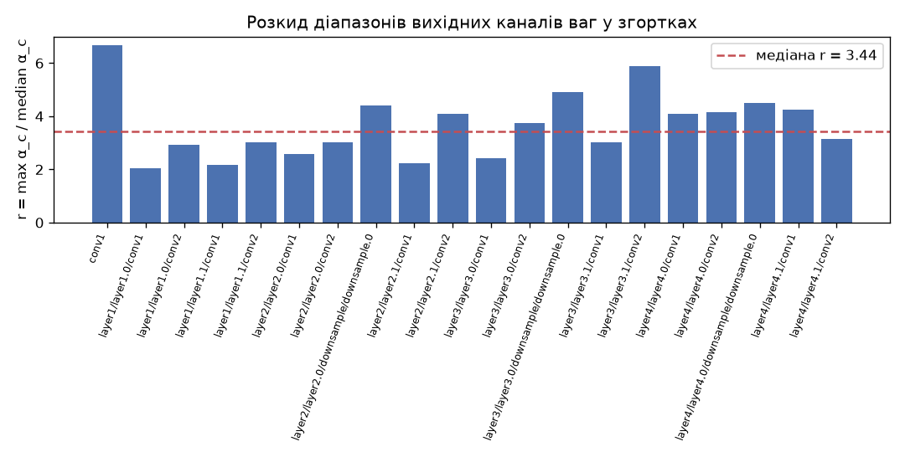
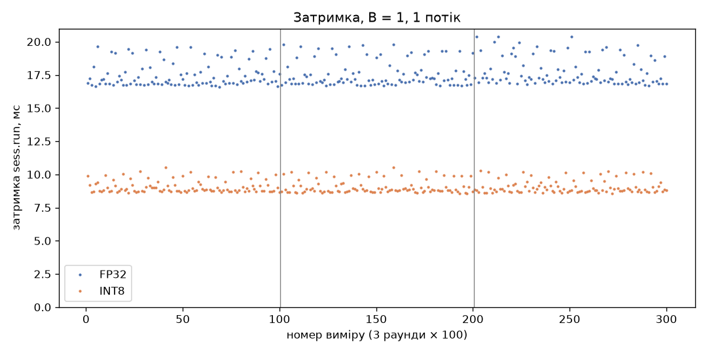

# ЛР4. FP32 проти INT8

Гула Дарина

## Що робить код і як запустити

Модель ЛР3 (`lab3_model.pt`, ResNet-18, frozen, зерно 3) експортується в ONNX (`lab4_fp32.onnx`).
Статична квантизація після навчання на 200 калібрувальних зображеннях train будує з неї INT8 (`lab4_int8.onnx`).
Далі на 1502 зображеннях test порівнюються якість і затримка на CPU, а дослідом із `per_channel=False`
перевіряється, як позначається на якості потензорне квантування ваг.

Потрібен [uv](https://docs.astral.sh/uv/), команда — з теки `lab4/`. `--data` — тека, в якій лежать
`seg_train/seg_train/` і `seg_test/seg_test/` набору
[Intel Image Classification](https://www.kaggle.com/datasets/puneet6060/intel-image-classification):

```bash
uv run python run.py --model ../lab3/lab3_model.pt --split ../lab3/split.csv --data <тека набору>
```

Команда виконує всі кроки по черзі (близько 4 хвилин на одному ядрі) і записує `lab4_results.json`,
файли `.onnx` (у git їх немає) і `results/`. Окремі кроки можна запустити через `--steps`
(`export,quantize,quality,ranges,per_tensor,latency`); `--out` задає теку для результатів.

| Файл | Що в ньому |
|---|---|
| `data.py` | `split.csv` і контроль поділу, калібрувальна вибірка та її контроль, перетворення |
| `model.py` | завантаження моделі ЛР3, експорт, підрахунок вузлів, сесія ORT, логіти пакетами по 64 |
| `quant.py` | `CalibrationDataReader`, `quant_pre_process`, `quantize_static`, діапазони каналів |
| `metrics.py` | macro-F1, accuracy, згода, b, c, Δacc ± SE |
| `latency.py` | протокол пункту 5 |
| `environment.py` | модель CPU, ОС, версії, наявність AVX2 / VNNI |
| `run.py` | команда запуску: кроки, контролі, `lab4_results.json` |
| `results/` | `channel_ranges.png`, `latency.png`, логіти test (`.npy`), журнали виводу `run_*.log` |

Усі числа нижче взято з `lab4_results.json` і журналів у `results/`; округлено лише для відображення.

**Середовище:** AMD Ryzen 5 5600H (Zen 3, x86-64: AVX2 є, AVX-512 і VNNI немає), Windows 11
(10.0.26300), Python 3.12.16, PyTorch 2.15.0+cpu, ONNX 1.23.2, ONNX Runtime 1.32.0, NumPy 2.5.5
(усе зафіксовано в `uv.lock`). Сесії: `CPUExecutionProvider`, 1 потік (`intra_op` = `inter_op` = 1),
пакет для затримки B = 1. Ноутбук на зарядці, важкі програми закрито.

**Відхилення від фіксованих налаштувань:** немає. Усі налаштування експорту, `quant_pre_process`,
`quantize_static` і сесії — рівно з таблиці умови. Від себе додано тільки діагностику: той самий
INT8-файл у сесії з `graph_optimization_level = ORT_DISABLE_ALL`. Вона потрібна для пояснення
згоди (пункт 3) і в таблиці не входить.

## Результати

### 1. Експорт і перевірка відповідності

Поділ: train 1200 / 11 993 084, test 1502 / 33 351 444 — збігається з умовою.

| Величина | Значення | Контроль |
|---|---|---|
| max \|z_ONNX − z_PyTorch\| (1502 × 6 логітів) | 1.17·10⁻⁵ | < 10⁻³ ✓ |
| Збіг класів (argmax) | 1.0000 | 1.0000 ✓ |
| macro-F1 PyTorch / ONNX FP32 | 0.8919 / 0.8919 | = ЛР3 (0.8919) ✓ |
| Вузлів Conv / BatchNormalization | 20 / 0 | 20 / 0 ✓ |
| Розмір `lab4_fp32.onnx` | 44.71 МБ | |

BN немає, бо в `eval()` експортер злив кожну BN із попередньою згорткою.

### 2. Калібрування й квантизація

Калібрувальна вибірка: 200 зображень, сума імен 1 921 470; buildings 40, forest 35, glacier 36,
mountain 33, sea 29, street 27 — збігається з умовою.
Калібрування бере train, бо діапазони активацій стають частиною моделі: калібрування на test
означало б підганяти модель під test.

| Етап | Час, с |
|---|---|
| Експорт (`torch.onnx.export`) | 0.56 |
| `quant_pre_process` | 0.34 |
| `quantize_static` (калібрування на 200 зображеннях + квантизація) | 2.91 |

`lab4_int8.onnx`: 11.30 МБ, формат QDQ (20 Conv, 75 DequantizeLinear, 33 QuantizeLinear).

### 3. Якість (test, n = 1502)

| Варіант | macro-F1 | accuracy | Згода з FP32 | b | c | Δacc ± SE |
|---|---|---|---|---|---|---|
| FP32 | 0.8919 | 0.8901 | 1 | 0 | 0 | |
| INT8 | 0.8797 | 0.8768 | 0.9394 | 34 | 54 | −0.0133 ± 0.0062 |

**Вердикт:** |b − c| = 20 > 2√(b + c) = 18.76, тобто погіршення INT8 відрізняється від шуму.
Напрям — INT8 гірша: −1.33 п.п. accuracy, −0.0122 macro-F1.

**Похибки.** SE однієї моделі з ЛР3 √(p(1 − p)/n) = 0.0081, парна SE(Δacc) = 0.0062: менша лише
в 1.29 раза. Парна похибка менша, бо обидва варіанти оцінено на тих самих зображеннях. Спільні для
обох помилки (FP32 і INT8 помиляються разом) у різницю не входять, шум дає тільки b + c
незгодних зображень. Тут таких аж 88. Якби квантизація змінювала мало відповідей (b + c ≈ 10,
як в еталоні), парна похибка була б у кілька разів меншою.

**Чому згода 0.94, а не ≈ 0.99, як в еталоні.** Діагностика: той самий `lab4_int8.onnx` без
оптимізацій графа (ORT не зливає QDQ у цілочисельні `QLinearConv`, а рахує згортки у float на
деквантованих значеннях) дає згоду **0.9920**, accuracy 0.8875, b = 4, c = 8 (у межах шуму).
Отже, калібрування правильне. Втрату дає цілочисельне множення на цьому CPU. Без VNNI ядро
AVX2 (`vpmaddubsw`) додає два добутки u8 × s8 у 16-бітне число з насиченням (максимум
2·255·127 = 64 770 > 32 767), і великі суми обрізаються. Про таке насичення на x86 без VNNI
попереджає й умова.

### 4. Дослід із потензорними вагами

Діапазони каналів, α_c = max|w| за вихідним каналом c, r = max_c α_c / median_c α_c:

| Згортка | Форма ваг | r | log₂ r, біта |
|---|---|---|---|
| `/conv1/Conv` | 64 × 3 × 7 × 7 | 6.67 | 2.74 |
| `/layer3/layer3.1/conv2/Conv` | 256 × 256 × 3 × 3 | 5.90 | 2.56 |
| `/layer3/layer3.0/downsample/downsample.0/Conv` | 256 × 128 × 1 × 1 | 4.92 | 2.30 |
| **Медіана за 20 згортками** | | **3.44** | **1.78** |

Отже, медіанному каналу потензорний крок коштує 1.78 біта з 8.



Прогноз (записано до запуску з `per_channel=False`, дослівно, коміт `44248de`):

> При per_channel=False згода з FP32 впаде нижче, ніж у per-channel INT8 (0.9394). Медіанний канал утрачає ≈1.78 біта з 8, тобто фактично має близько 6 біт, а в першій згортці conv1 звичайний канал утрачає 2.74 біта, і ця похибка проходить далі через усю мережу. Тому більше картинок змінять клас. Перемикання підуть в обидва боки, тож у macro-F1 вони частково скомпенсуються, і згода впаде помітніше, ніж macro-F1. Але FP32 правий на 89% зображень, тому псуватиметься більше, ніж виправлятиметься: c зросте сильніше за b, і різниця з FP32 буде понад шум (|b−c| > 2√(b+c)) у бік гіршої якості.

Результат (`lab4_int8_per_tensor.onnx`, 11.23 МБ):

| Варіант | macro-F1 | accuracy | Згода з FP32 | b | c | Δacc ± SE |
|---|---|---|---|---|---|---|
| FP32 | 0.8919 | 0.8901 | 1 | 0 | 0 | |
| INT8 per-channel | 0.8797 | 0.8768 | 0.9394 | 34 | 54 | −0.0133 ± 0.0062 |
| INT8 per-tensor | 0.8931 | 0.8915 | 0.9807 | 15 | 13 | +0.0013 ± 0.0035 |

Для per-tensor |b − c| = 2 ≤ 2√28 = 10.58, тобто різниця з FP32 не відрізняється від шуму.

Діагностика (ті самі файли без цілочисельних ядер, QDQ у float):

| Варіант | Згода з FP32 | b | c |
|---|---|---|---|
| per-channel | 0.9920 | 4 | 8 |
| per-tensor | 0.9867 | 9 | 10 |

**Зіставлення з прогнозом.**
- Що згода реагує сильніше за macro-F1 і перемикання йдуть в обидва боки, справдилося: 28
  перемикань (b = 15, c = 13), а macro-F1 майже не змінився.
- Що згода впаде нижче 0.9394, а якість погіршиться понад шум, не справдилося. На цьому CPU
  per-tensor дав згоду 0.9807 і різницю в межах шуму.
- Сам механізм прогнозу підтверджує діагностика: у float потензорні ваги справді знижують
  згоду (0.9920 → 0.9867). Але на цілочисельних ядрах AVX2 переважає насичення. Per-channel
  розтягує кожен канал на весь діапазон int8, тож 16-бітні суми частіше переповнюються. У
  per-tensor більшість каналів використовують лише частину діапазону (медіанний — у
  2^1.78 ≈ 3.4 раза меншу), і насичень менше.

**Чому згода чутливіша за macro-F1 і чому розходження компенсуються в b − c.** Згода рахує кожне
перемикання класу (b + c), а якість — лише різницю виправлених і зіпсованих (b − c). Квантизація
зсуває логіти майже випадково відносно правильної відповіді. Тому перемикаються переважно
зображення біля межі рішення, на яких FP32 і так «вгадує», і вони йдуть в обидва боки
(15 проти 13), взаємно скорочуючись.

### 5. Затримка

Протокол: обидві сесії створено заздалегідь. Вхід — перше зображення test (`split.csv`), float32
1 × 3 × 160 × 160, підготовлений заздалегідь. 3 раунди, у кожному спершу FP32, потім INT8, по 20
прогрівальних викликів і 100 вимірів. Вимір — лише `sess.run` між двома `time.perf_counter()`.

| Варіант | Файл, МБ | p50, мс | p95, мс | p50 за раундами, мс |
|---|---|---|---|---|
| FP32 | 44.71 | 17.18 | 19.59 | 17.10 / 17.16 / 17.25 |
| INT8 | 11.30 | 8.85 | 10.16 | 8.85 / 8.84 / 8.86 |

Прискорення p50_FP32 / p50_INT8 = **1.94**, відношення p95 = 1.93, файл менший у 3.96 раза.
Відрізки p50 за раундами [17.10; 17.25] і [8.84; 8.86] не перетинаються, тобто зміну затримки
виміряно.



p50 і p95 замість середнього: розподіл затримки асиметричний, з рідкими довгими викидами
(переривання ОС, інші процеси). Середнє вони зсувають, а медіану — ні; p95 окремо показує хвіст.

## Висновок

1. **Ресурси.** Файл зменшився в 3.96 раза (44.71 → 11.30 МБ), p50 — у 1.94 раза (17.18 → 8.85 мс),
   p95 — у 1.93 раза (19.59 → 10.16 мс). Відрізки p50 за раундами не перетинаються, отже зміну
   затримки виміряно.
2. **Якість.** INT8 гірша за FP32 понад шум: Δacc = −0.0133 ± 0.0062 (|b − c| = 20 > 18.76),
   macro-F1 0.8919 → 0.8797, згода 0.9394. Причина — насичення цілочисельних ядер AVX2:
   без них той самий файл дає згоду 0.9920 і різницю в межах шуму.
3. **Чому прискорення 1.94, а не 4.** Чотирикратно зменшуються лише байти ваг. ResNet-18 при B = 1
   робить на кожен байт ваг багато множень, тож за моделлю даху (лекція 9) вона впирається в
   обчислення, а не в пам'ять. Прискорення визначає швидкість цілочисельного множення. Ryzen 5 5600H
   не має VNNI: кожен 8-бітний скалярний добуток виконується кількома інструкціями AVX2 через 16-біт
   проміжок, тому INT8 приблизно вдвічі, а не вчетверо, продуктивніша за FP32 FMA. На CPU з VNNI чи
   ARM dot product (як Apple M3 Pro в еталоні, 3.91×) прискорення ближче до 4.
4. **Придатність.** На цьому ноутбуці INT8 із `per_channel=True` вдвічі швидша, але дає реальну
   втрату якості (−1.3 п.п. accuracy понад шум). Для цієї задачі я б її не брала без перевірки
   альтернатив. Потензорний варіант з досліду пункту 4 мав якість, не відмінну від FP32
   (Δacc = +0.0013 ± 0.0035). Його затримку протокол не вимагає, тож тут вона не виміряна.
5. Усі висновки стосуються саме AMD Ryzen 5 5600H і ONNX Runtime 1.32.0: на CPU з VNNI і якість INT8,
   і прискорення будуть іншими.

## Використані інструменти

- Claude Code (Anthropic) — допомога з написанням коду, перевірок і оформленням README.
- PyTorch і torchvision — ResNet-18, перетворення, експорт `torch.onnx.export`.
- ONNX, ONNX Runtime — граф, сесії, `quant_pre_process`, `quantize_static`.
- scikit-learn — `f1_score(average="macro")`; Matplotlib — графіки.
- Документація PyTorch, ONNX Runtime (розділ про квантизацію), uv.
- Стороннього коду з інших джерел не використано.
